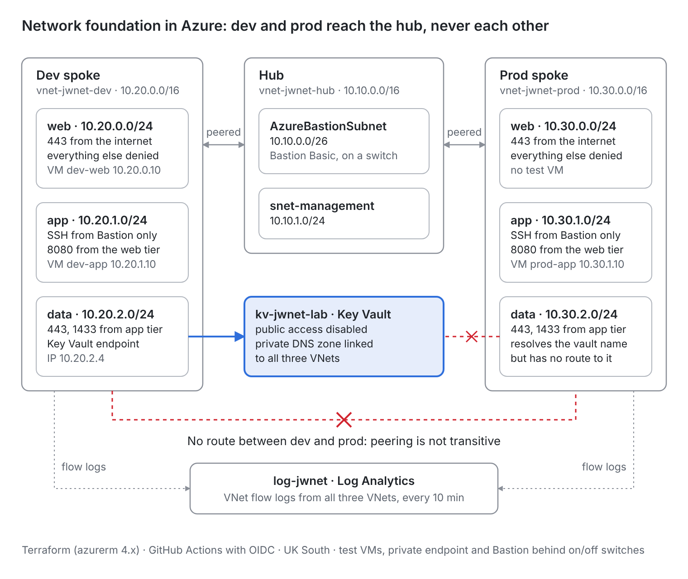

# Network foundation in Azure

A hub-and-spoke network for a company moving its first apps to Azure, with separate dev and prod environments, three-tier traffic rules, admin access through Azure Bastion, Key Vault reachable only over a private endpoint, and VNet flow logs for auditing. Everything is built with Terraform and deployed by GitHub Actions through pull requests.



**Video walkthrough (2 min):** ___

## The problem

The security team wanted a network foundation before any app is deployed: nothing reachable from the internet except through controlled entry points, dev and prod kept apart so a dev mistake can't reach production, admin access without SSH open to the internet, and a record of allowed and denied traffic. Full requirements and acceptance tests: [docs/requirements.md](docs/requirements.md).

## Architecture

| Network | Range | Subnets |
| --- | --- | --- |
| Hub (`vnet-jwnet-hub`) | 10.10.0.0/16 | AzureBastionSubnet 10.10.0.0/26 · snet-management 10.10.1.0/24 |
| Dev spoke (`vnet-jwnet-dev`) | 10.20.0.0/16 | web 10.20.0.0/24 · app 10.20.1.0/24 · data 10.20.2.0/24 |
| Prod spoke (`vnet-jwnet-prod`) | 10.30.0.0/16 | web 10.30.0.0/24 · app 10.30.1.0/24 · data 10.30.2.0/24 |

| Subnet | Allowed in | Everything else internal |
| --- | --- | --- |
| web | HTTPS 443 from the internet | Denied (priority 4000) |
| app | SSH 22 from the Bastion subnet; 8080 from web | Denied |
| data | 443 and 1433 from app | Denied |

- **Isolation by routing:** spokes peer only to the hub, and peering isn't transitive, so dev and prod have no route to each other.
- **No public IPs on VMs:** admins connect through Azure Bastion in the hub; subnets have no default outbound internet.
- **Private platform access:** Key Vault has public access disabled and is reached through a private endpoint in the dev data subnet, with private DNS linked to every VNet.
- **Auditability:** VNet flow logs on all three VNets, processed by traffic analytics into Log Analytics.

## What it proves

Each test was run against three small test VMs (`dev-web` 10.20.0.10, `dev-app` 10.20.1.10, `prod-app` 10.30.1.10).

| Test | Result | Evidence |
| --- | --- | --- |
| Dev can't reach prod | No route to 10.30.0.0/16 in `dev-app`'s effective routes; next hop `None`; TCP test: `prod NOT reachable` |  |
| NSG between tiers | From `dev-web` to `dev-app`: `8080 open`, `22 blocked` |  |
| Which rule decides | IP flow verify on port 22: `Allow` from the Bastion subnet (`app-allow-ssh-bastion`), `Deny` from the web tier (`app-deny-vnet`) |  |
| Private endpoint | Laptop: public IP, `ForbiddenByConnection`. `dev-app`: private IP ___, reachable. `prod-app`: private IP, **not** reachable |  |
| Flow logs | KQL on `NTANetAnalytics`: 8080 `Allowed`, 22 `Denied`, with the rule names |  |
| Admin access | SSH to `dev-app` through Bastion; no internet from the VM |  |

Two findings worth knowing:

- `prod-app` resolved Key Vault's private IP but couldn't connect to it. **DNS and routing are separate layers**: having the right address isn't the same as having a path.
- The dev-to-prod attempt never appeared in the flow logs as "Denied". It had no route, so no NSG ever saw it. **Not every blocked connection shows up as a deny.**

## How it works

```
infra/
  bootstrap.sh          state storage, pipeline identity (OIDC), role assignments
  network.tf            hub VNet + module "spoke" for_each { dev, prod }
  modules/spoke/        VNet, subnets, NSGs, rules, ASG, peering both ways
  monitoring.tf         flow logs, storage, Log Analytics, traffic analytics
  lab.tf                Key Vault, private DNS, and switch-controlled parts
  terraform.tfvars      enable_test_vms / enable_private_endpoint / enable_bastion
.github/workflows/
  ci.yml                shellcheck, terraform fmt, validate, plan on every PR
  deploy.yml            terraform apply after merge to main
docs/
  requirements.md       brief, requirements, address plan, acceptance tests
  decisions/            architecture decision records
```

- **One module, every environment:** adding a spoke is one line in `network.tf`; the rules are identical by design.
- **Lab switches:** the parts billed by the hour (test VMs, private endpoint, Bastion) are booleans in `terraform.tfvars`, turned on and off through pull requests, so every change is planned, reviewed and logged.
- **No secrets in GitHub:** the pipeline signs in to Azure with OpenID Connect federated credentials.

## Decisions

| # | Decision |
| --- | --- |
| [0001](docs/decisions/0001-hub-and-spoke.md) | Hub-and-spoke instead of one VNet or a full mesh |
| [0002](docs/decisions/0002-bastion-basic.md) | Bastion Basic, switched on only when needed |
| [0003](docs/decisions/0003-key-vault-private-endpoint.md) | Key Vault through a private endpoint and private DNS |
| [0004](docs/decisions/0004-private-subnets.md) | Private subnets with no default outbound internet |
| [0005](docs/decisions/0005-spoke-module.md) | One spoke module, NSG rules as separate resources |
| [0006](docs/decisions/0006-flow-logs.md) | VNet flow logs with traffic analytics |

## Cost

- With the switches off, the network costs close to nothing: VNets, subnets, NSGs and the DNS zone are free or pennies, and flow logs are charged per GB.
- The test session ran for ___ hours with the VMs and private endpoint on, and Bastion was on for ___ minutes. Actual cost from Cost Management: **£___**.

## What I'd do in production

- **Azure Firewall (or an NVA) in the hub** with user-defined routes, for controlled, logged spoke-to-spoke and outbound traffic.
- **A NAT gateway or firewall for outbound updates**, instead of no outbound access.
- **Azure Policy** to require an NSG on every subnet and deny rules that allow SSH or RDP from the internet. Separate rule resources in Terraform don't catch rules added by hand ([ADR 0005](docs/decisions/0005-spoke-module.md)).
- **Bastion Standard**, always on, with native client support.
- **Shared private endpoints in the hub**, or one vault per environment.
- **Flow log retention and workspace caps** sized to the audit requirement.

## Run it yourself

1. `infra/bootstrap.sh` creates the state storage and the pipeline identity, and prints the values for GitHub variables.
2. Set the variables `AZURE_CLIENT_ID`, `AZURE_TENANT_ID` and `AZURE_SUBSCRIPTION_ID` in GitHub (no secrets needed).
3. Open a pull request; CI shows the plan. Merge to deploy.
4. To test, set the switches in `infra/terraform.tfvars` to `true` in a pull request, then back to `false` when finished.
